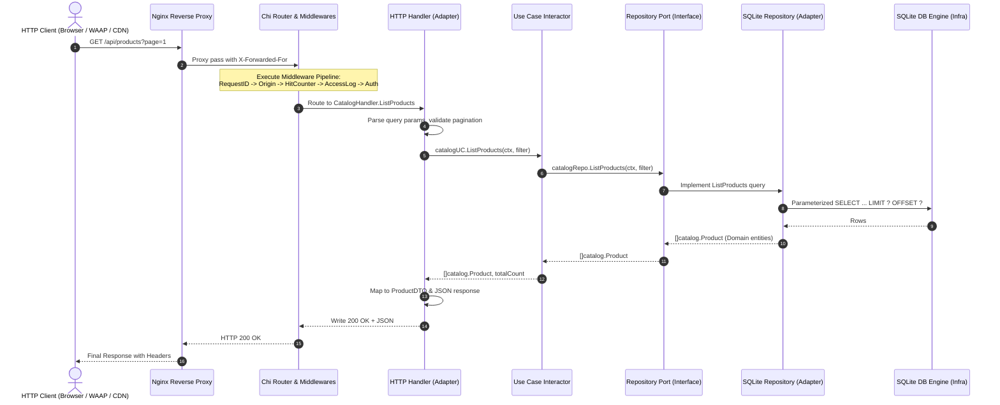
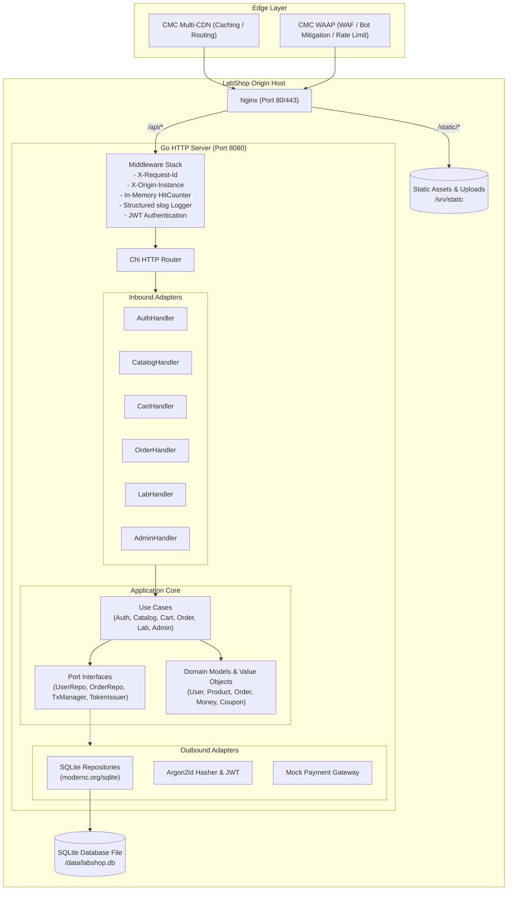

# LabShop Architecture Documentation

This document describes the architectural design, layer boundaries, dependency rules, and implementation patterns for the LabShop origin server.

---

## 1. Clean Architecture Overview

LabShop is structured strictly according to **Uncle Bob's Clean Architecture** principles. The primary objective is **independence of frameworks, database engines, and UI layers**, keeping the core business logic testable, maintainable, and isolated from external volatility.

```
                    ┌───────────────────────────────────────────────┐
                    │               Frameworks & Drivers            │
                    │      (cmd, SQLite DB, Nginx, Config, Log)     │
                    │   ┌───────────────────────────────────────┐   │
                    │   │          Interface Adapters           │   │
                    │   │    (HTTP Handlers, SQLite Repos,      │   │
                    │   │      Argon2, JWT, Mock Payment)       │   │
                    │   │   ┌───────────────────────────────┐   │   │
                    │   │   │    Application Business Rules │   │   │
                    │   │   │     (Usecases, Port Interfaces)│   │   │
                    │   │   │   ┌───────────────────────┐   │   │   │
                    │   │   │   │  Enterprise Entities  │   │   │   │
                    │   │   │   │  (Domain Models,      │   │   │   │
                    │   │   │   │   Value Objects,      │   │   │   │
                    │   │   │   │   Domain Errs)        │   │   │   │
                    │   │   │   └───────────────────────┘   │   │   │
                    │   │   └───────────────────────────────┘   │   │
                    │   └───────────────────────────────────────┘   │
                    └───────────────────────────────────────────────┘
```

### Layer Breakdown

| Layer | Package Path | Allowed Imports | Forbidden Imports | Responsibilities |
| :--- | :--- | :--- | :--- | :--- |
| **1. Domain** | `internal/domain/...` | Go standard library only (`time`, `strings`, `errors`, etc.) | **NO** `net/http`, `database/sql`, JSON tags, external libs, adapters, usecases | Core business entities (`User`, `Product`, `Order`, `Review`, `Ticket`), Value Objects (`Money`), domain errors (`errs`), and invariant validation rules. |
| **2. Usecase** | `internal/usecase/...` | Go stdlib, `internal/domain` | **NO** `internal/adapter`, `internal/infrastructure`, external third-party libs | Application orchestration, user interaction flows, business transaction coordination. Declares all **Port Interfaces** (`UserRepository`, `CatalogRepository`, `TokenIssuer`, `HitCounter`, `TxManager`). |
| **3. Adapter** | `internal/adapter/...` | Go stdlib, `domain`, `usecase/port`, third-party adapter drivers | **NO** direct coupling to other specific adapters without interfaces | Implements Port interfaces declared in usecases: HTTP handlers with Chi router, SQLite repositories with pure Go driver, JWT issuer, Argon2 password hasher, mock payment gateway. |
| **4. Infrastructure** | `internal/infrastructure/...` | All layers, configuration, OS drivers | N/A | Bootstrapping, database initialization, schema migration execution, environment variable parsing, slog logger setup. |
| **Entry Points** | `cmd/...` | Infrastructure, Adapters, Usecases | N/A | Dependency injection wiring and application lifecycles (`cmd/server`, `cmd/genassets`, `cmd/smoke`). |

---

## 2. The Dependency Rule & Automated Enforcement

> **The Dependency Rule**: Source code dependencies must point ONLY inward, toward higher-level policies. Nothing in an inner circle can know anything at all about something in an outer circle.

### Architecture Test Suite (`internal/archtest`)
Compliance is enforced in CI via automated Go code AST inspection in `internal/archtest/arch_test.go`:
- `TestDomainOnlyImportsStdlib`: Parses all AST imports in `internal/domain` and fails if any non-stdlib or forbidden package (`database/sql`, `net/http`) is found.
- `TestUsecaseOnlyImportsStdlibAndDomain`: Parses AST imports in `internal/usecase` and fails if any adapter or infrastructure package is imported.

---

## 3. Data Flow Diagram

The diagram below illustrates the complete lifecycle of an incoming HTTP request through the architectural rings:



### End-to-End Component Flow



---

## 4. Step-by-Step Guide: How to Add a New Use Case

Follow this standardized procedure to implement new features while preserving Clean Architecture purity:

### Step 1: Define Domain Entity (`internal/domain`)
Create a new package or add to an existing entity under `internal/domain/<entity>/`:
- Plain Go structs with NO JSON tags, NO database tags.
- Use explicit constructors that validate business invariants.
- Return domain errors defined in `internal/domain/errs`.

```go
// internal/domain/wishlist/wishlist.go
package wishlist

import (
    "time"
    "labshop/internal/domain/errs"
)

type WishlistItem struct {
    ID        string
    UserID    string
    ProductID string
    CreatedAt time.Time
}

func NewItem(id, userID, productID string, now time.Time) (*WishlistItem, error) {
    if id == "" || userID == "" || productID == "" {
        return nil, errs.ErrInvalidInput
    }
    return &WishlistItem{
        ID:        id,
        UserID:    userID,
        ProductID: productID,
        CreatedAt: now,
    }, nil
}
```

### Step 2: Define Port Interfaces (`internal/usecase/port`)
Declare the storage and external dependency contracts in `internal/usecase/port/`:

```go
// internal/usecase/port/wishlist.go
package port

import (
    "context"
    "labshop/internal/domain/wishlist"
)

type WishlistRepository interface {
    AddItem(ctx context.Context, item *wishlist.WishlistItem) error
    ListItems(ctx context.Context, userID string) ([]wishlist.WishlistItem, error)
    DeleteItem(ctx context.Context, userID, itemID string) error
}
```

### Step 3: Implement Use Case & Unit Tests (`internal/usecase`)
Implement the usecase in `internal/usecase/<name>/`:
- Write unit tests using in-memory fake repositories (aim for >= 80% coverage).
- Do not import any adapters.

```go
// internal/usecase/wishlist/wishlist.go
package wishlist

import (
    "context"
    "labshop/internal/domain/wishlist"
    "labshop/internal/usecase/port"
)

type Usecase struct {
    repo  port.WishlistRepository
    idGen port.IDGenerator
    clock port.Clock
}

func New(repo port.WishlistRepository, idGen port.IDGenerator, clock port.Clock) *Usecase {
    return &Usecase{repo: repo, idGen: idGen, clock: clock}
}

func (uc *Usecase) Add(ctx context.Context, userID, productID string) (*wishlist.WishlistItem, error) {
    item, err := wishlist.NewItem(uc.idGen.NewID(), userID, productID, uc.clock.Now())
    if err != nil {
        return nil, err
    }
    if err := uc.repo.AddItem(ctx, item); err != nil {
        return nil, err
    }
    return item, nil
}
```

### Step 4: Implement Storage Adapter (`internal/adapter/repository/sqlite`)
Implement the port using parameterized SQLite SQL:
- Never concatenate query strings.
- Map database rows to domain models.

```go
// internal/adapter/repository/sqlite/wishlist.go
package sqlite

import (
    "context"
    "database/sql"
    "labshop/internal/domain/wishlist"
)

type WishlistRepository struct {
    db *sql.DB
}

func NewWishlistRepository(db *sql.DB) *WishlistRepository {
    return &WishlistRepository{db: db}
}

func (r *WishlistRepository) AddItem(ctx context.Context, it *wishlist.WishlistItem) error {
    query := `INSERT INTO wishlist_items (id, user_id, product_id, created_at) VALUES (?, ?, ?, ?)`
    _, err := r.db.ExecContext(ctx, query, it.ID, it.UserID, it.ProductID, it.CreatedAt)
    return err
}
```

### Step 5: Implement HTTP Handler & DTOs (`internal/adapter/http/handler`)
Create DTO structs with JSON tags, parse requests using `decodeJSON` (`DisallowUnknownFields`), and use `presenter` for response serialization:

```go
// internal/adapter/http/handler/wishlist.go
package handler

import (
    "net/http"
    "labshop/internal/adapter/http/middleware"
    "labshop/internal/adapter/http/presenter"
    wishlistuc "labshop/internal/usecase/wishlist"
)

type WishlistHandler struct {
    uc *wishlistuc.Usecase
}

func (h *WishlistHandler) AddItem(w http.ResponseWriter, r *http.Request) {
    claims := middleware.GetClaims(r.Context())
    // decode input, execute uc.Add, presenter.JSON(w, http.StatusCreated, dto)
}
```

### Step 6: Register Route in Chi Router (`internal/adapter/http/router.go`)
Mount the handler under appropriate middleware groups (e.g., `middleware.RequireAuth`).

### Step 7: Update OpenAPI Specification & Run Contract Tests
Add the new paths and schema components to `api/openapi.yaml`. Run:
```bash
go test -v ./test/contract/...
```

### Step 8: Wire Dependencies in Server (`cmd/server/main.go`)
Instantiate repository, usecase, handler, and inject them into `BusinessHandlers`.

---

## 5. Architectural Guardrails Summary

1. **Parameter Queries Only**: Every database query in SQLite adapters MUST use `?` placeholders. No `fmt.Sprintf` SQL construction.
2. **DTO Isolation**: Domain models are never directly serialized as HTTP responses. Always map through explicit DTOs.
3. **No Intentional Vulnerabilities**: The backend origin is secure by design. Vulnerability testing in labs evaluates the WAAP edge filter, not unpatched origin flaws.
4. **Idempotency**: Critical state mutating endpoints (checkout, payment) support `Idempotency-Key` headers to safely handle edge network retries.
