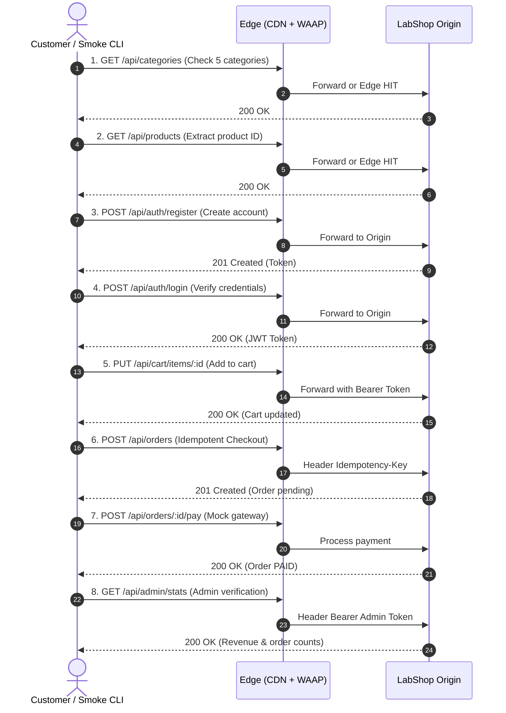

# CMC WAAP & Multi-CDN Test Plan & Scenario Matrix

This document provides a comprehensive test plan mapping CMC WAAP and CMC Multi-CDN product features to LabShop test scenarios, endpoints, expected HTTP behaviors, and step-by-step verification procedures.

---

## 1. Scope & Test Objectives

The test plan evaluates two enterprise edge technologies fronting the LabShop origin:
1. **CMC Multi-CDN**: Edge caching, cache key normalizations, dynamic revalidation, provider routing strategies, purge lifecycle, and compression.
2. **CMC WAAP (Web Application & API Protection)**: OWASP Top 10 web attack mitigation, API protection, rate limiting, bot defense, and IP/Geo access control.

### Topology Routing Reference

| Routing Host | Network Topology | Objective |
| :--- | :--- | :--- |
| **Direct** (`direct.<domain>`) | Client ➔ Origin | Baseline control: origin latency, raw headers, un-cached origin behavior. |
| **WAAP Only** (`waap.<domain>`) | Client ➔ CMC WAAP ➔ Origin | Security testing: verify inspection without edge cache interference. |
| **CDN Only** (`cdn.<domain>`) | Client ➔ CMC Multi-CDN ➔ Origin | Caching evaluation: HIT/MISS, ETag 304, compression, failover. |
| **Full** (`full.<domain>`) | Client ➔ Multi-CDN ➔ WAAP ➔ Origin | End-to-end production architecture: edge caching + WAAP protection. |

---

## 2. Multi-CDN Feature & Scenario Matrix

### C1 — Site Onboarding & Edge Delegation
- **CMC Feature**: Sites Management (`multi-cdn/guides/quan-ly-va-them-site-moi`)
- **Portal Configuration**:
  1. Go to **CDN > Sites > Add Site**.
  2. Enter origin IP/Domain, Port 80/443, HTTP protocol.
  3. Update DNS CNAME to the CMC-assigned Multi-CDN domain.
- **Endpoint**: `GET /api/time`
- **Expected Results**:
  - Direct: Server header is `labshop-origin` (or origin instance ID), no `X-Cache` header.
  - Multi-CDN (Request 1): `X-Cache: MISS` (origin response).
  - Multi-CDN (Request 2): `X-Cache: HIT`, served from edge POP.
- **Verification Command**:
  ```bash
  curl -i http://cdn.labshop.local/api/time
  ```

---

### C2 — Origin Cache-Control Header Compliance
- **CMC Feature**: Origin Cache Control (`multi-cdn/guides/origin-control`)
- **Portal Configuration**:
  1. Set **Cache Policy** to **Follow Origin Headers** (`Cache-Control: public, max-age=60`).
- **Endpoint**: `GET /api/cache/public`
- **Expected Results**:
  - Origin sends: `Cache-Control: public, max-age=60`.
  - First request: Edge registers `MISS`.
  - Requests within 60s: Edge serves `HIT` with increasing `Age` header.
  - Request after 61s: Edge re-fetches from origin (`MISS` or `REVALIDATED`).
- **Verification Command**:
  ```bash
  curl -i http://cdn.labshop.local/api/cache/public
  ```

---

### C2b — Edge Page Rules for Static Assets
- **CMC Feature**: Page Rules Cache Overrides (`multi-cdn/guides/page-rule`)
- **Portal Configuration**:
  1. Add Page Rule: URL pattern `/static/*` ➔ Force Edge Cache TTL = 86400s (1 Day).
- **Endpoint**: `GET /static/img/products/p01.jpg`
- **Expected Results**:
  - Edge caches image regardless of origin header; `X-Cache: HIT`.
- **Verification Command**:
  ```bash
  curl -i http://cdn.labshop.local/static/img/products/p01.jpg
  ```

---

### C3 — Origin Control: Host Header & SNI Routing
- **CMC Feature**: Origin Host Header Override (`multi-cdn/guides/origin-control`)
- **Portal Configuration**:
  1. Configure Origin Settings ➔ Custom Host Header = `origin.labshop.local`.
- **Endpoint**: `GET /api/headers`
- **Expected Results**:
  - Inspected response shows `"headers": { "Host": "origin.labshop.local" }`.
- **Verification Command**:
  ```bash
  curl -s http://cdn.labshop.local/api/headers | jq .headers.Host
  ```

---

### C4 — Multi-Provider Routing & Load Distribution
- **CMC Feature**: Multi-Provider Routing Policies (`multi-cdn/guides/cau-hinh-chien-luoc-dinh-tuyen-toi-cac-provider`)
- **Portal Configuration**:
  1. In **Routing Strategy**, configure multi-provider distribution (e.g. 50% Provider A, 50% Provider B or Latency-based / Cost-based).
- **Endpoint**: `GET /api/time`
- **Expected Results**:
  - Requests from different regions or successive bursts show different edge `Server` or `Via` provider signatures.
- **Verification Command**:
  ```bash
  for i in {1..10}; do curl -sI http://cdn.labshop.local/api/time | grep -iE "(server|via|x-cdn)"; done
  ```

---

### C5 — Cache Configuration by URL Pattern
- **CMC Feature**: Cache Configuration by Path (`multi-cdn/guides/cau-hinh-cache`)
- **Portal Configuration**:
  1. Path `/api/products*`: Edge Cache TTL = 120s.
  2. Path `/api/cart*`: Edge Cache = Bypass / No Cache.
- **Endpoints**: `GET /api/products` and `GET /api/cart`
- **Expected Results**:
  - `/api/products`: `X-Cache: HIT` after initial miss.
  - `/api/cart`: Always `X-Cache: BYPASS` or `MISS`.
- **Verification Command**:
  ```bash
  curl -i http://cdn.labshop.local/api/products
  curl -i -H "Authorization: Bearer <token>" http://cdn.labshop.local/api/cart
  ```

---

### C6 — Origin Bypass on Sensitive / Dynamic Endpoints
- **CMC Feature**: Cache Bypass Rules (`multi-cdn/guides/origin-control`)
- **Portal Configuration**:
  1. Rule: When origin returns `Cache-Control: private, no-store`, edge MUST NOT cache.
- **Endpoint**: `GET /api/cache/no-store`
- **Expected Results**:
  - Every single request returns `X-Cache: MISS` (or `BYPASS`). Timestamp changes on every request.
- **Verification Command**:
  ```bash
  curl -i http://cdn.labshop.local/api/cache/no-store
  ```

---

### C7 — Query String Cache Key Behavior
- **CMC Feature**: Cache Key Configuration (`multi-cdn/guides/cau-hinh-cache`)
- **Portal Configuration**:
  1. Mode A: **Ignore Query String** — `/api/products?sort=asc` and `/api/products?sort=desc` share the same cache item.
  2. Mode B: **Include Query String (Standard)** — Unique query strings produce separate cache entries.
- **Endpoint**: `GET /api/products?sort=price_asc` vs `GET /api/products?sort=price_desc`
- **Expected Results**:
  - In Standard Mode: Request with `sort=price_asc` misses then hits; request with `sort=price_desc` misses separately.
- **Verification Command**:
  ```bash
  curl -i "http://cdn.labshop.local/api/products?sort=price_asc"
  curl -i "http://cdn.labshop.local/api/products?sort=price_desc"
  ```

---

### C8 — ETag & Conditional HTTP Revalidation
- **CMC Feature**: Origin Revalidation (`multi-cdn/guides/origin-control`)
- **Portal Configuration**:
  1. Enable 304 Not Modified forwarding and edge revalidation.
- **Endpoint**: `GET /api/cache/etag`
- **Expected Results**:
  1. First request returns HTTP 200 with header `ETag: "..."`.
  2. Subsequent request with `If-None-Match: "..."` returns **HTTP 304 Not Modified** with zero payload bytes.
- **Verification Command**:
  ```bash
  ETAG=$(curl -sI http://cdn.labshop.local/api/cache/etag | grep -i ETag | awk '{print $2}' | tr -d '\r\n')
  curl -i -H "If-None-Match: $ETAG" http://cdn.labshop.local/api/cache/etag
  ```

---

### C9 — Edge Cache Purge & Instant Invalidation
- **CMC Feature**: Cache Purge (`multi-cdn/guides/cau-hinh-cache`)
- **Portal Configuration**:
  1. Open **CDN > Sites > Purge Cache**.
  2. Enter URL: `http://cdn.labshop.local/static/docs/sample.pdf` (or Purge All).
  3. Submit Purge request.
- **Endpoint**: `GET /static/docs/sample.pdf`
- **Expected Results**:
  - Immediately following purge, the next request returns `X-Cache: MISS`. Subsequent requests return `X-Cache: HIT`.
- **Verification Command**:
  ```bash
  curl -i http://cdn.labshop.local/static/docs/sample.pdf
  ```

---

### C10 — Edge Content Compression (Gzip / Brotli)
- **CMC Feature**: Content Optimization (`multi-cdn/guides/opimization`)
- **Portal Configuration**:
  1. Enable **Gzip** and **Brotli** compression in CDN optimization settings.
- **Endpoint**: `GET /api/payload?kb=500`
- **Expected Results**:
  - Client request with `Accept-Encoding: gzip, br` receives `Content-Encoding: gzip` (or `br`).
  - Response size transferred over the wire is dramatically reduced (< 50KB vs 500KB raw).
- **Verification Command**:
  ```bash
  curl -i -H "Accept-Encoding: gzip" http://cdn.labshop.local/api/payload?kb=500
  ```

---

### C16 — Origin Failover & Error Page Caching
- **CMC Feature**: Origin Failover & Error Handling (`multi-cdn/usage-scenarios/us5`)
- **Portal Configuration**:
  1. Enable failover to secondary origin on HTTP 502/503/504 errors.
  2. Cache 404/500 responses for 5 seconds.
- **Endpoint**: `GET /api/status/502`
- **Expected Results**:
  - CDN routes to backup origin or serves branded custom error page.
- **Verification Command**:
  ```bash
  curl -i http://cdn.labshop.local/api/status/502
  ```

---

### C17 — SSL/TLS Edge Termination
- **CMC Feature**: SSL/TLS Management (`multi-cdn/guides/ssl-tls`)
- **Portal Configuration**:
  1. Upload custom certificate or enable Let's Encrypt managed SSL on CMC portal.
  2. Set Origin SSL mode to **End-to-End SSL** or **Flexible**.
- **Endpoint**: `GET /api/health`
- **Expected Results**:
  - HTTPS connection establishes cleanly without certificate errors (`curl -iv https://cdn.labshop.local/api/health`).

---

### C18 — Rate Limiting on CDN Edge
- **CMC Feature**: Firewall Rules / Edge Rate Limiting (`multi-cdn/guides/firewall-rule`)
- **Portal Configuration**:
  1. Set rate limit: max 60 requests per minute per IP for path `/api/*`.
- **Endpoint**: Burst requests to `GET /api/time`
- **Expected Results**:
  - Requests exceeding quota receive **HTTP 429 Too Many Requests** directly from the edge POP without hitting origin.
- **Verification Command**:
  ```bash
  for i in {1..70}; do curl -s -o /dev/null -w "%{http_code}\n" http://cdn.labshop.local/api/time; done
  ```

---

## 3. CMC WAAP Security Feature & Scenario Matrix

### W1 — WAAP Application Onboarding
- **CMC WAAP Feature**: App Management & DNS Routing (`waap/guide/app-management`)
- **Portal Configuration**:
  1. Navigate to **WAAP > Applications > Add Application**.
  2. Set upstream origin IP: `<EC2_ORIGIN_IP>`, Port: 80 (or 443).
  3. CNAME DNS record `waap.labshop.local` ➔ WAAP proxy domain.
- **Endpoint**: `GET /api/health`
- **Expected Results**:
  - Request routes through WAAP proxy. Origin logs show WAAP edge IP in `RemoteAddr` and client IP in `X-Forwarded-For`.
- **Verification Command**:
  ```bash
  curl -i http://waap.labshop.local/api/health
  ```

---

### W2 — SQL Injection (SQLi) Defense
- **CMC WAAP Feature**: Rules Management / OWASP Top 10 (`waap/guide/rules-management`)
- **Portal Configuration**:
  1. Enable WAF Rule Group: **SQL Injection (SQLi)** in **BLOCK** mode.
- **Endpoint**: `GET /api/products?q=%27%20OR%201=1--`
- **Expected Results**:
  - Direct Origin: Returns HTTP 200 with empty search results (secure parameter query prevents injection).
  - WAAP Route: Blocked at edge! Returns **HTTP 403 Forbidden** with WAAP block template. Origin server receives 0 requests.
- **Verification Command**:
  ```bash
  curl -i "http://waap.labshop.local/api/products?q=%27%20OR%201=1--"
  ```

---

### W3 — Cross-Site Scripting (XSS) Mitigation
- **CMC WAAP Feature**: Core Rule Set — XSS (`waap/guide/rules-management`)
- **Portal Configuration**:
  1. Enable WAF Rule Group: **Cross-Site Scripting (XSS)** in **BLOCK** mode.
- **Endpoint**: `GET /api/echo?name=<script>alert(document.cookie)</script>`
- **Expected Results**:
  - WAAP intercepts malicious script payload; returns **HTTP 403 Forbidden**.
- **Verification Command**:
  ```bash
  curl -i "http://waap.labshop.local/api/echo?name=%3Cscript%3Ealert(document.cookie)%3C/script%3E"
  ```

---

### W4 — Path Traversal & LFI Protection
- **CMC WAAP Feature**: Path Traversal Protection (`waap/guide/rules-management`)
- **Portal Configuration**:
  1. Enable Rule Group: **Local File Inclusion (LFI) & Path Traversal**.
- **Endpoint**: `GET /api/echo/../../../../etc/passwd`
- **Expected Results**:
  - Edge inspection flags directory traversal sequence `../`; returns **HTTP 403 Forbidden**.
- **Verification Command**:
  ```bash
  curl -i "http://waap.labshop.local/api/echo/../../../../etc/passwd"
  ```

---

### W5 — API Protection & Rate Limiting
- **CMC WAAP Feature**: API Protection & Rate Limiting (`waap/guide/api-protection`, `waap/guide/rate-limiting`)
- **Portal Configuration**:
  1. In **Rate Limiting**, create rule:
     - URL Path: `/api/auth/login`
     - Method: `POST`
     - Threshold: 5 requests / 10 seconds per IP
     - Action: Block for 60 seconds (HTTP 429)
- **Endpoint**: `POST /api/auth/login`
- **Expected Results**:
  - 1st to 5th request: HTTP 401 (invalid creds) or 200 from origin.
  - 6th request: **HTTP 429 Too Many Requests** or **403 Forbidden** from WAAP edge.
- **Verification Command**:
  ```bash
  for i in {1..7}; do
    curl -s -o /dev/null -w "%{http_code}\n" -X POST http://waap.labshop.local/api/auth/login \
      -H "Content-Type: application/json" -d '{"email":"test@bad.com","password":"bad"}'
  done
  ```

---

### W6 — Bot Management & Anti-Scraping
- **CMC WAAP Feature**: Bot Management (`waap/guide/bot-management`)
- **Portal Configuration**:
  1. Enable **Bot Detection**:
     - Detect Automated Scrapers / Empty User-Agent
     - Challenge headless browsers with JS challenge or CAPTCHA
- **Endpoint**: `GET /api/products` with empty or suspicious User-Agent (`python-requests`, `curl`)
- **Expected Results**:
  - Request with empty User-Agent: Blocked with **HTTP 403** or challenged.
  - Legitimate browser: Allowed through to origin.
- **Verification Command**:
  ```bash
  curl -i -H "User-Agent: python-requests/2.28.0" http://waap.labshop.local/api/products
  curl -i -H "User-Agent: " http://waap.labshop.local/api/products
  ```

---

### W7 — Sensitive Header Inspection & Redaction
- **CMC WAAP Feature**: View Logs & Header Verification (`waap/guide/view-logs`)
- **Portal Configuration**:
  1. Inspect WAAP-appended headers (`X-Forwarded-For`, `X-WAF-Request-ID`).
- **Endpoint**: `GET /api/headers`
- **Expected Results**:
  - Response JSON reflects client IP at start of `x_forwarded_for` array.
  - Sensitive headers (`Authorization`, `Cookie`) are masked as `[REDACTED]` by origin.
- **Verification Command**:
  ```bash
  curl -s http://waap.labshop.local/api/headers | jq .
  ```

---

### W8 — IP Whitelist / Blacklist & Geo-Fencing
- **CMC WAAP Feature**: Whitelist Management & Geo-Access Control (`waap/guide/whitelist-management`, `waap/guide/geo-access-control`)
- **Portal Configuration**:
  1. Configure Geo-Access: Allow only Vietnam (`VN`), block all other country codes.
  2. Configure IP Blacklist: Add test client IP to Blacklist.
- **Endpoint**: `GET /api/health`
- **Expected Results**:
  - Requests originating from blocked Geo/IP receive **HTTP 403 Geo Blocked**.
- **Verification Command**:
  ```bash
  curl -i http://waap.labshop.local/api/health
  ```

---

## 4. End-to-End E-Commerce Flow Verification (S1)

This flow validates the complete business engine and data consistency across edge layers:



---

## 5. Automated Verification Checklist

Run these commands before any release or lab session to guarantee system readiness:

```bash
# 1. Verify Clean Architecture boundaries
go test -v ./internal/archtest/...

# 2. Verify OpenAPI 3.0.3 syntax & Chi route contract coverage
go test -v ./test/contract/...

# 3. Verify all unit & integration tests
go test -v ./...

# 4. Run full 18-step smoke test suite against running instance
go run ./cmd/smoke/main.go -base-url=http://localhost
```
